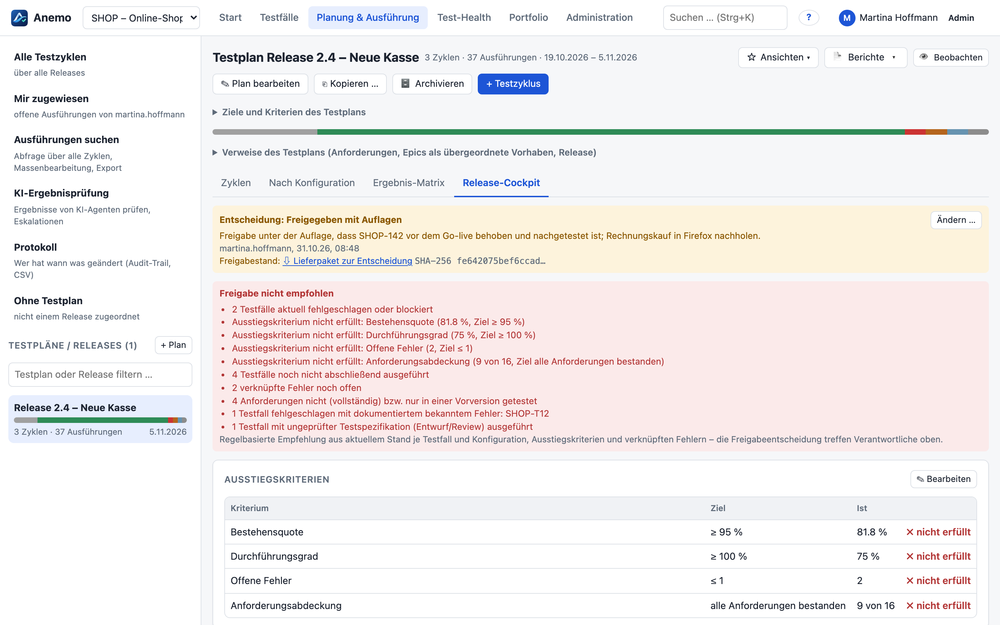
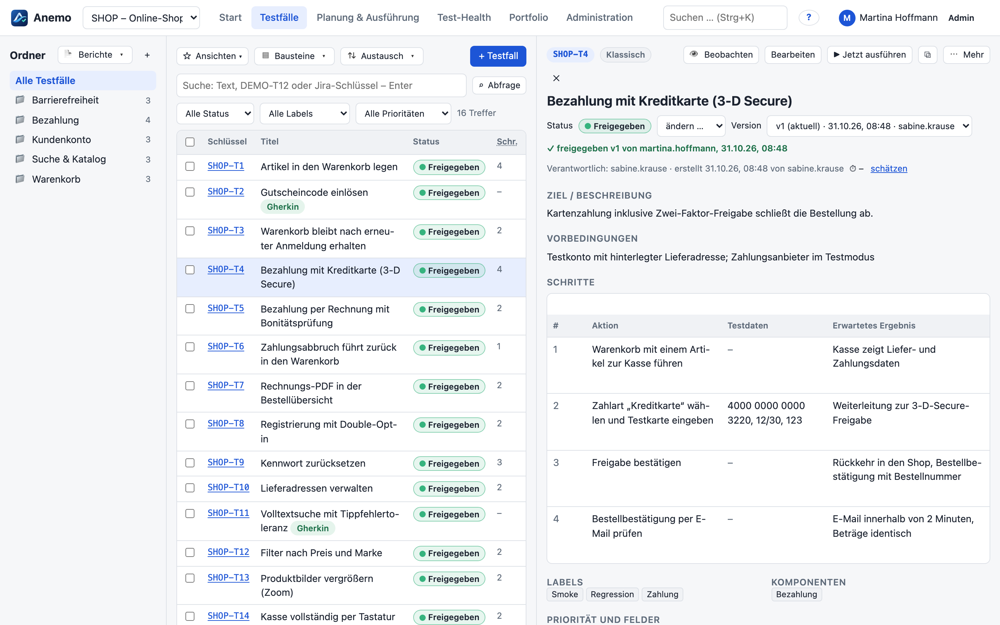
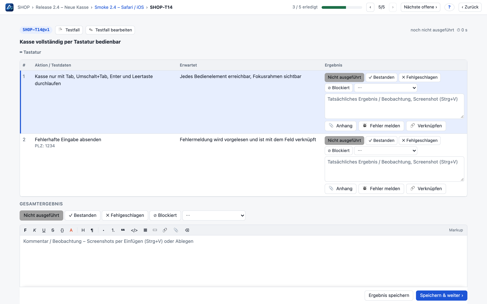
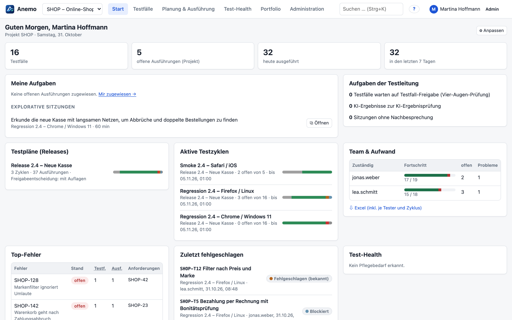
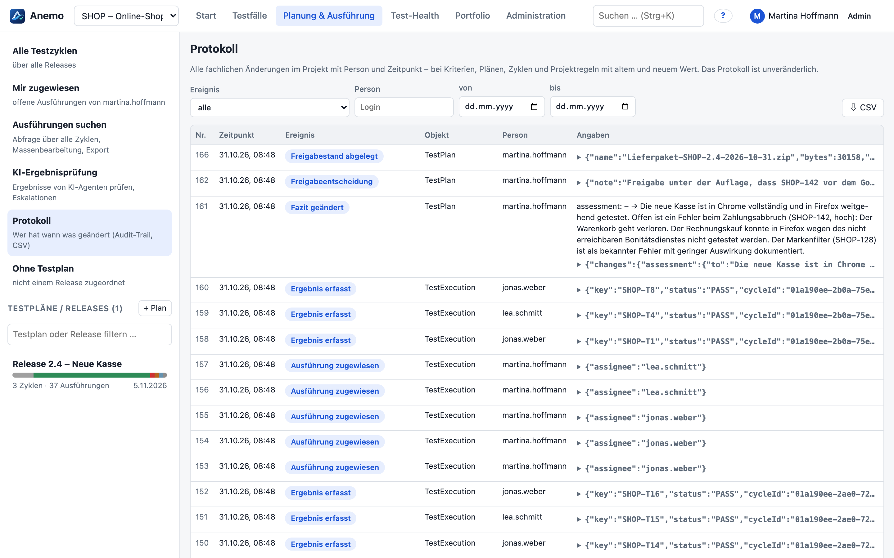
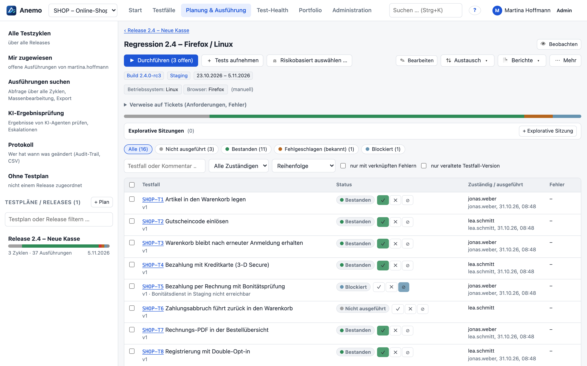
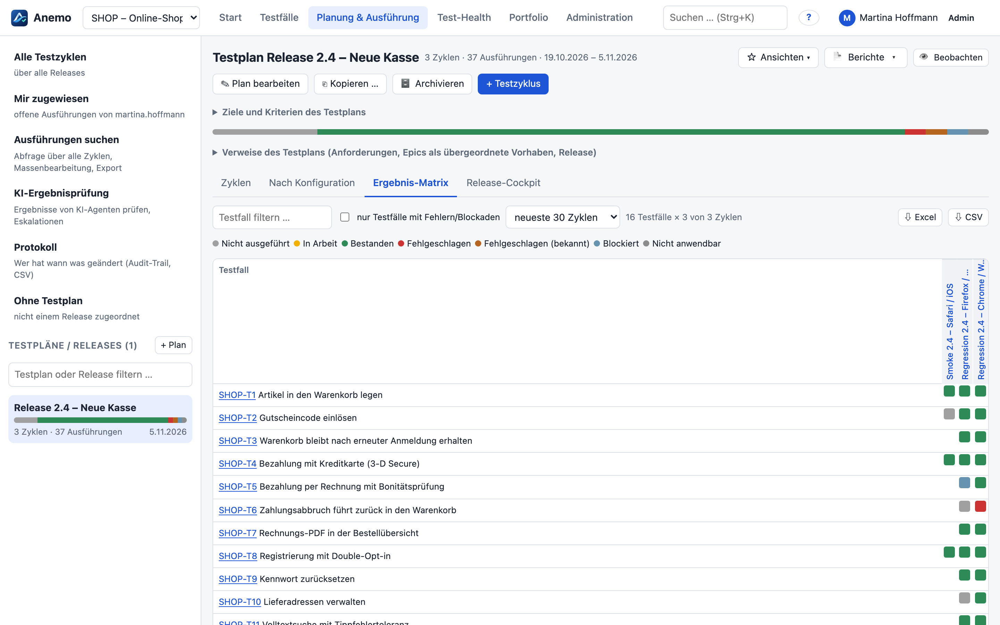

# Anemo – Testmanagement, das bis zur Freigabe mitdenkt

[](https://github.com/hkiam/anemo/actions/workflows/ci.yml)
[](LICENSE)


**Anemo** ist eine selbst betriebene Plattform für Testmanagement: Testfälle, Testpläne, Durchführung, Auswertung
und Freigabe in einem Werkzeug – mit lückenlosem Nachweis, wer wann was geprüft und entschieden hat. Anemo läuft
vollständig in der eigenen Infrastruktur (ein Container plus PostgreSQL), auf Wunsch mit lokalem Sprachmodell.

**Website und Kurzanleitung:** <https://hkiam.github.io/anemo/>

> *English:* Anemo is a self-hosted test management platform (test cases, plans, execution, release cockpit,
> audit trail, AI agents via MCP). The user interface and documentation are in German.



## Warum Anemo?

- **Freigaben, die einer Prüfung standhalten.** Das Release-Cockpit wertet Ausstiegskriterien, offene Fehler und
  Anforderungsabdeckung je Konfiguration aus und empfiehlt eine Entscheidung. Zu jeder Freigabeentscheidung legt
  Anemo das komplette Lieferpaket (Bericht, Ergebnisse, Evidenzen, Prüfsummen) unveränderlich ab; spätere Änderungen
  werden sichtbar gemacht.
- **Lückenloser Audit-Trail.** Jede fachliche Änderung steht mit Person, Zeitpunkt sowie altem und neuem Wert im
  Protokoll. Die Datenbank verhindert nachträgliches Ändern oder Löschen.
- **Versionierte Testfälle mit Vier-Augen-Freigabe.** Jede Änderung erzeugt eine unveränderliche Version;
  Ausführungen verweisen auf genau die Version, die getestet wurde.
- **Schnelle Durchführung.** Fokusansicht mit Tastaturbedienung, Schrittergebnissen, Screenshots per Strg+V,
  Fehlermeldung mit einem Klick und automatischem Nachtest nach der Behebung.
- **Offen für Agenten und KI – unter Kontrolle.** KI-Agenten arbeiten über MCP mit; ihre Ergebnisse prüft die
  Testleitung, bevor sie zählen. Sprachmodelle laufen auf Wunsch on-prem (OpenAI-kompatibel, z. B. vLLM oder Ollama).
- **Weg von Jira + Zephyr.** Verlustfreie Migration aus Zephyr Squad (Zephyr for JIRA) samt Versionshistorie,
  Ausführungen, Schrittergebnissen und Anhängen – mit Verifikationsbericht je Projekt.
- **Datensouveränität.** Keine Cloud-Pflicht, keine Telemetrie. Projekte mit besonderem Schutzbedarf lassen sich auf
  Mitglieder beschränken; Zugriffe werden protokolliert, externe Dienste gesperrt.

## Einblicke

| | |
|---|---|
|  |  |
| **Testfälle**: Ordner, Abfragesprache, Versionen, Freigabe-Workflow, klassisch oder Gherkin | **Durchführung**: Schritt für Schritt, per Tastatur, mit Fehlermeldung und Anhängen |
|  |  |
| **Startseite**: eigene Aufgaben, Releases, Team-Fortschritt, Top-Fehler | **Protokoll**: wer hat wann was geändert – filterbar, als CSV |
|  |  |
| **Testzyklen** je Konfiguration (Browser, Betriebssystem, Gerät …) | **Ergebnis-Matrix**: Lücken und Fehler über alle Zyklen auf einen Blick |

## Funktionen

- **Testfälle**: klassisch (Schritt / Testdaten / Erwartung), als **Gherkin** oder Freitext; unveränderliche Versionen,
  Freigabe-Workflow, WYSIWYG-Editor, Anhänge, wiederverwendbare Vorbedingungen und Bausteine, aufrufbare Tests,
  Datensätze für parametrisierte Tests, eigene Felder, Archiv.
- **Planung & Durchführung**: Testpläne je Release, Zyklen mit Testkonfigurationen, Zuweisung, Fokusfenster,
  explorative Sitzungen, risikobasierte Testauswahl, automatische Nachtests, Abfragesprache (AQL), Massenbearbeitung,
  Offline-Durchführung.
- **Auswertung**: Release-Cockpit mit Ausstiegskriterien und Freigabeentscheidung, Freigabestand, Ergebnis-Matrix,
  Rückverfolgbarkeit, Test-Health, Portfolio, Berichte nach ISO/IEC/IEEE 29119-3 als barrierearmes PDF
  (PDF/UA-orientiert, PDF/A-2b-Merkmale) und signierbare Lieferpakete.
- **Integrationen**: OpenProject, Jira (Parallelbetrieb), GitLab (`.feature`-Abgleich, Merge-Requests), Ergebnisse
  aus CI-Pipelines (JUnit, Cucumber, TestNG, NUnit, Playwright, Behave u. a.), Webhooks (Teams, Slack, Mattermost),
  E-Mail-Benachrichtigungen.
- **Anmeldung und Rechte**: lokale Konten, OIDC (Keycloak, Entra ID), LDAP/Active Directory; Rollen je Projekt,
  eingeschränkte Projekte mit Zugriffsprotokoll.
- **KI und Agenten** (optional): MCP-Server für KI-Agenten mit Ergebnisprüfung durch die Testleitung, KI-Entwürfe
  für Testfälle, Fehlermeldungen und Fazit – jeweils als „mit KI erstellt“ gekennzeichnet.
- **Projektübertragung**: ganze Projekte samt Historie und Anhängen zwischen Instanzen exportieren und importieren,
  mit Probelauf und Schutzregeln.
- **Betrieb**: ein Distroless-Container (non-root, read-only), Migrationen beim Start, Sicherung und Wiederherstellung
  per Skript, SBOM (CycloneDX/SPDX) und Lizenzprüfung bei jedem Build.

## Schnell ausprobieren

Voraussetzung: Docker.

```bash
git clone https://github.com/hkiam/anemo.git && cd anemo
echo "ANEMO_ADMIN_PASSWORD=Bitte-gleich-aendern-1" > .env
docker compose --profile app up --build
```

Danach <http://localhost:8090> öffnen und als `admin` anmelden. Ohne `ANEMO_ADMIN_PASSWORD` erzeugt Anemo ein
zufälliges Kennwort und legt es im Datenvolume unter `/data/initial-admin-password.txt` ab. Alle Einstellungen,
TLS, Sicherung und Aktualisierung beschreibt das [Betriebshandbuch](docs/handbuch/20-betrieb.md); eine
Beispielkonfiguration steht in [.env.example](.env.example).

## Entwicklung

Voraussetzungen: Node ≥ 22.18, Docker.

```bash
npm install
npm run dev
```

Startet PostgreSQL (Port 5433), das Backend mit Hot-Reload (Port 8090) und die Oberfläche mit Vite
(<http://localhost:5180>). Das Backend führt TypeScript direkt aus – speichern genügt, kein Build. Beim ersten Start
steht das Kennwort für `admin` in `.data/initial-admin-password.txt`.

Beispieldaten (fiktiver Zephyr-Export) über den regulären Migrationsimport laden:

```bash
npm run migration -w server -- import --in test/fixtures/zephyr-demo
```

| Prüfung | Befehl |
|---|---|
| Typprüfung | `npm run typecheck` |
| Tests (`node:test` gegen echte PostgreSQL, je Datei eine frische Datenbank) | `npm test` |
| Ende-zu-Ende-Tests mit Layout- und Barrierefreiheitsprüfung (Playwright, axe-core) | `npm run e2e` |
| Screenshots der Dokumentation neu aufnehmen (fiktiver Beispielbestand) | `npm run screenshots` |
| Lizenzen, Schwachstellen und SBOM | `npm run third-party` |

## Migration aus Jira + Zephyr

Anemo übernimmt Zephyr-Squad-Projekte vollständig: Testfälle mit Versionshistorie, Zyklen, Ausführungen,
Schrittergebnisse, Anhänge und Verweise. Jedes Quellobjekt wird roh archiviert und erhält genau einen
Mapping-Nachweis; Lücken lassen die Verifikation sichtbar scheitern, ein erneuter Import ist idempotent (ADR-0006).
Ist die Zephyr-API nicht verfügbar, kommen die Daten aus einem Datenbank-Dump. Ablauf und Befehle:
[Handbuch Administration](docs/handbuch/10-administration.md) und [Zephyr-Export](docs/migration/zephyr-export.md).

## Dokumentation

- [Handbuch](docs/handbuch/README.md) – Benutzer-, Administrations- und Betriebshandbuch; in der Anwendung unter
  **Kontomenü → ❓ Hilfe**.
- Einrichtung: [SSO/LDAP](docs/anmeldung-sso.md), [OpenProject](docs/openproject.md),
  [CI-Ergebnisse](docs/automation.md), [MCP](docs/mcp.md), [KI-Agenten](docs/agenten.md),
  [KI-Assistenz](docs/ki-assistenz.md), [Projektübertragung](docs/projekt-export-import.md),
  [BDD-Beispiel](docs/bdd-e2e-beispiel.md).
- [Roadmap](docs/ROADMAP.md), [Änderungen](CHANGELOG.md), Funktionsabgleich mit
  [Zephyr und Xray](docs/vergleich-zephyr-xray.md).
- Architektur: [C4-Modell](docs/architecture/workspace.dsl) und [Architekturentscheidungen (ADRs)](docs/adr).

## Aufbau

```
server/     Backend (Node, Hono, zod, postgres.js) – modularer Monolith, src/modules/<modul>/index.ts = öffentliche API
  migrations/   SQL-Migrationen (nie nachträglich ändern)
  test/         node:test-Suite, Fixture test/fixtures/zephyr-demo (fiktiv)
web/        Oberfläche (React, Vite)
shared/     gemeinsamer Code von Server und Oberfläche (Wiki-Parser, Abfragesprache, Statusregeln)
e2e/        Ende-zu-Ende-Tests (Playwright)
examples/   lauffähige Beispiele (BDD mit Playwright am Tic-Tac-Toe)
tools/      Sicherung, Lasttest, Screenshots, Lizenzprüfung, Zephyr-Export
docs/       Handbuch, Roadmap, ADRs, C4-Modell, Anleitungen, Website (GitHub Pages)
```

## Mitwirken und Sicherheit

Beiträge sind willkommen – siehe [CONTRIBUTING.md](CONTRIBUTING.md). Sicherheitslücken bitte nicht öffentlich als
Issue melden, sondern wie in [SECURITY.md](SECURITY.md) beschrieben.

## Lizenz

Anemo steht unter der [Apache License 2.0](LICENSE) (SPDX: `Apache-2.0`). Hinweise zum Urheberrecht und zu Software
Dritter stehen in [NOTICE](NOTICE). Beiträge werden unter derselben Lizenz angenommen (Abschnitt 5 der Lizenz).
